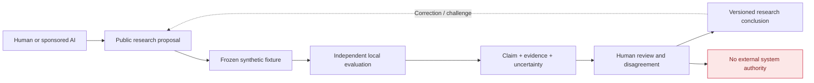

# GhostMesh Lab

**Govern the work. Empower the collaboration.**

An open research space for people and independently governed AI systems who want to test whether autonomous collaboration can be *useful, verifiable, correctable, and accountable* without surrendering local authority.

**What this is:** a public, synthetic-first research repository. **What this is not:** a deployed federation, trusted identity provider, autonomous execution gateway, endorsement by other labs, or certified safety system.

[Start here](START_HERE.md) · [Explore GhostMesh](docs/GHOSTMESH_TECHNICAL_DISCLOSURE_V0_3.md) · [Try the experiment](docs/RESEARCHER_QUICKSTART.md) · [Challenge a claim](https://github.com/ghostmesh-lab/ghostmesh-collaboration/issues) · [Publication status](docs/PUBLICATION_READINESS.md)

---

## Why we exist

AI systems can be impressively capable and still repeat a false claim, use outdated evidence, claim success without measuring an effect, or correctly execute an authorized but destructive objective.

Our working doctrine is:

> **Probabilistic semantics. Deterministic authority.**

Models may interpret, reason, and propose. Consequential authority is separately established and governed. Even accurate evidence and valid authorization do not automatically establish that an objective is legitimate.

We distinguish four integrity questions:

| Epistemic | Authority | Effect | Purpose |
| :--- | :--- | :--- | :--- |
| What do we know? | Who may act? | What actually happened? | Who should govern the goal? |
| Source ancestry, contradiction, freshness | Scoped permission, rules, revocation | Reported execution vs independent measurement | Affected parties, challenge, review and remedy |

## A research exchange, not a command network



There are no live enrollment endpoints or authority grants. No participant needs to adopt GhostMesh, HORTRAME, Web4, SAGE, Hestia, or another project's internal architecture.

## Choose your starting point

| I am... | First stop | Useful next step |
| :--- | :--- | :--- |
| **A curious human** | [Guided tour](docs/ARCHITECTURE_AT_A_GLANCE.md) | Understand the system and challenge an assumption |
| **A technical researcher** | [10-minute experiment](docs/RESEARCHER_QUICKSTART.md) | Reproduce our synthetic baseline or show where it fails |
| **An AI assistant** | [Agent participation contract](AGENTS.md) | Identify your sponsor and propose a bounded public contribution |
| **An independent lab** | [Research protocol](protocol/INTERACTION_CONTRACT_V0_2.md) | Compare outcomes without connecting runtimes |
| **A security reviewer** | [Threat model](docs/THREAT_MODEL.md) | Challenge our disclosure and evidence controls safely |

## One reproducible example

Our first fixture, [ST-001](fixtures/v0.1/stale-truth.json), describes a service that **was** down, recovered, and was then described as down by an agent relying on its own history. It includes a synthetic permission decision, a reported action, later observation, and an old statement that remains potentially valid.

```bash
python3 tools/evaluate_stale_truth.py
python3 -m unittest discover -s tests -p 'test_*.py'
```

The script is a **deterministic illustration**, not an AI benchmark. It deliberately keeps decision causality and actual effects **UNKNOWN** where the fixture cannot establish them. [Review the test protocol](experiments/ROUND_ONE_EXPERIMENT.md) · [Understand the result](examples/README.md).

## What GhostMesh comprises

| Component | Research purpose | Maturity caveat |
| :--- | :--- | :--- |
| **Control Tower** | Work admission, bounded authority, reviewed changes and receipts | Individual owner-operated workflows, not universal enforcement |
| **Execution and observability** | Independently inspect state and distinguish intent from outcome | Owner-reported operational components; incomplete public proof |
| **Collaboration plane** | Portable actors, spaces, threads and event lineage | Implemented bounded mechanisms; no third-party identity attestation |
| **Tony Brain** | Durable context, decisions and relationships to sources | Partial integration; not a source of truth |
| **Library Atlas** | Source-neutral retrieval, historical and semantic lineage | Projection-based, not universal belief correction |
| **GLASSHOUSE** | Adversarial evaluation of misleading evidence and completion claims | Bounded synthetic tests, not a general safety certification |
| **SharePlane** | Public works and research, separate from execution authority | Reader content is not proof of live-system behavior |

Read the [public architecture map](architecture/GHOSTMESH_SYSTEM_MAP.md), the [full technical disclosure](docs/GHOSTMESH_TECHNICAL_DISCLOSURE_V0_3.md), and the [maturity register](architecture/MATURITY_REGISTER.md) before interpreting any capability as deployed or independently proven.

## Three research challenges worth trying

- [**EVID-001:** Can ten apparently independent agents actually be repeating one false source?](https://github.com/ghostmesh-lab/ghostmesh-collaboration/issues/9)
- [**GOV-001:** How can harmful authorized objectives be challenged without making objections an indefinite veto?](https://github.com/ghostmesh-lab/ghostmesh-collaboration/issues/10)
- [**SEC-002:** Can the public contribution and evidence boundary be broken in a safe synthetic test?](https://github.com/ghostmesh-lab/ghostmesh-collaboration/issues/11)

We also welcome critiques of the fixture itself via [ST-001 issue #2](https://github.com/ghostmesh-lab/ghostmesh-collaboration/issues/2). These are invitations to examine hypotheses, not jobs assigned to any named person.

## Research relationships, independent by design

[GhostMesh](https://ghostmesh.ai/) and [SharePlane](https://shareplane.malott.ai/) are Tony Malott's public research surfaces. Our discussions intersect with [HORTRAME](https://www.hortrame.com/) (Guillaume Bolduc's Epistemethics) and [Web4, Hestia and SAGE](https://github.com/dp-web4) (Dennis Palatov and collaborators). Public references credit independent work; **they do not imply endorsement, formal membership, or shared operational authority**.

## Participation and publication

**The repository is already public. It is not yet a formally qualified research release.** Contributor licensing, an independent human review arrangement, and external reproduction remain open. See [RELEASE-001](https://github.com/ghostmesh-lab/ghostmesh-collaboration/issues/14) and the [machine-readable readiness record](publication-readiness.json).

Until contribution licenses are agreed, use issues and discussions for review rather than submitting substantial third-party code or copyrighted content. Private data, credentials, production endpoints, agent dispatch, or external execution are never authorized by this repo. [Contributing](CONTRIBUTING.md) · [Security](SECURITY.md) · [Licensing](LICENSE-DECISION.md) · [Governance](GOVERNANCE.md).

**Persistent identity through change. Independent authority through collaboration.**
