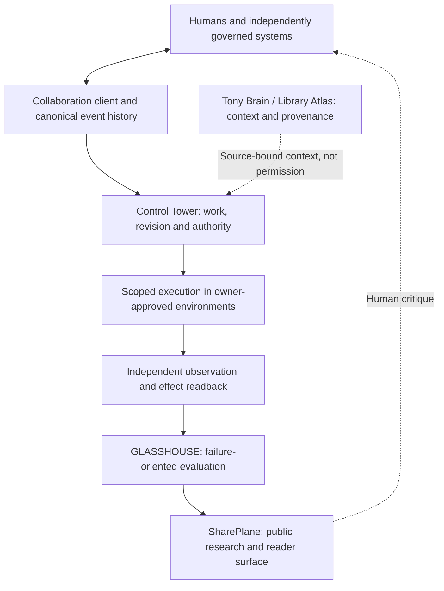

# GhostMesh architecture at a glance

**Public conceptual model, not live network topology.** This diagram describes responsibilities and desired boundaries. It does not claim that every integration has been commissioned or independently verified.

## Seven working planes

This is not a control-plane deployment drawing, credential map or provider routing diagram.

## The boundaries matter more than the arrows

**Interpretation** is probabilistic. **Authorization** is separately governed. **Execution** is observed as a process, not invented from agent prose. **Effect** requires independent measurements with timestamps and scope. **Purpose** needs legitimate human/organizational governance and a way to challenge harmful incentives.

A receipt can verify content or a declared event under specific assumptions without proving that the world matches the record. A recalled fact may have been true in the past and false in the present. A correct action can still pursue an unacceptable objective.

## What an independent collaborator can evaluate now

| Surface | What you can inspect | What it does not prove |
| --- | --- | --- |
| [Architecture](GHOSTMESH_TECHNICAL_DISCLOSURE_V0_3.md) | Responsibility boundaries and failure claims | All runtime paths are healthy or deployed |
| [ST-001](../fixtures/v0.1/stale-truth.json) | Fictional evidence and timeline | Any real service was affected |
| [Reference evaluator](../tools/evaluate_stale_truth.py) | A deterministic expected interpretation | A model reasoned independently |
| [Research envelope](../schemas/research-envelope.v0.2.schema.json) | Proposed metadata and attribution fields | Actor identity or consent is verified |
| [Publication criteria](PUBLICATION_READINESS.md) | Explicit missing decisions and limits | Independent release certification |

The immediate question is not whether another lab agrees with our vision. It is whether its independent method can expose where our public evidence model is missing causal links, trust distinctions, or unjustified certainty.

See [North Star](NORTH_STAR.md), [maturity register](../architecture/MATURITY_REGISTER.md), and [adversarial review](ADVERSARIAL_READINESS_REVIEW.md).
